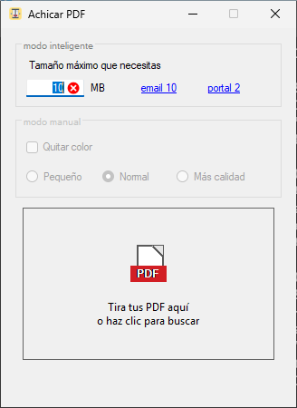
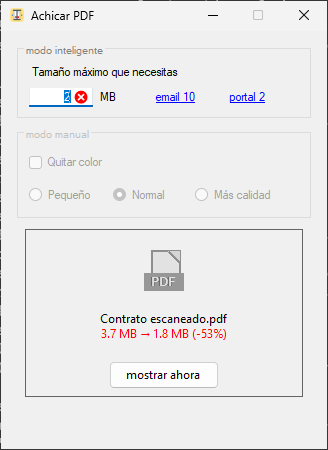

# Achicar PDF

Achicar PDF es una app simple para Windows que reduce PDFs escaneados usando
Ghostscript. Está pensada para tirar un PDF, decir cuánto puede pesar como
máximo y guardar el resultado en la misma carpeta del original.




## Descargar

La última versión está en la página de releases:

- [Achicar.PDF.x64.exe](https://github.com/franciscoxc/achicar-pdf/releases/latest/download/Achicar.PDF.x64.exe): Windows x64.
- [Achicar.PDF.arm.exe](https://github.com/franciscoxc/achicar-pdf/releases/latest/download/Achicar.PDF.arm.exe): Windows ARM64.

Los SHA-256 de cada versión están en las notas de su release. Como el `.exe` no
está firmado, Windows puede mostrar "Windows protegió tu PC": toca
`Más información` y luego `Ejecutar de todas formas`.

## Cómo se usa

1. Abre `Achicar PDF`.
2. Si Ghostscript no está instalado (o tienes una versión vieja con fallas de
   seguridad), la app descarga el instalador oficial de Artifex, comprueba su
   firma digital y lo abre: Windows pide permiso y después se avanza con
   `Siguiente` hasta el final. Artifex no permite instalarlo en silencio.
3. Escribe el tamaño máximo que necesitas, en MB enteros, o usa los atajos
   `email 10` y `portal 2`. La app recuerda el último tamaño.
4. Tira uno o varios PDF (o una carpeta) al recuadro, o haz clic para buscar uno.
5. El recuadro muestra en rojo cuánto se ahorró, y `mostrar ahora` abre la
   carpeta con el PDF achicado seleccionado.

También puedes arrastrar PDFs sobre el ícono del `.exe` o usar
`Enviar a → Achicar PDF` en el menú del botón derecho del Explorador: la app
agrega ese atajo sola al abrirse.

El resultado se guarda junto al original (o en Documentos, si esa carpeta no
deja escribir). El nombre indica el PPI usado y si quedó en Color o en Gris.

## Modos

- **Inteligente** (con tamaño máximo): primero prueba sin bajar la resolución; si
  no entra, busca el PPI más alto que entra, entre 50 y 300. Si ni a 50 PPI en
  color entra, prueba en gris.
- **Manual** (sin tamaño máximo): `Pequeño` (75 PPI), `Normal` (100 PPI) o
  `Más calidad` (150 PPI), con la opción `Quitar color`.

Si el resultado pesa más que el original, no guarda nada. Si el PDF tiene firma
digital, avisa antes, porque al achicarlo la firma deja de ser válida.

## Ghostscript

Achicar PDF no incluye Ghostscript dentro del ejecutable. Si falta, descarga el
instalador oficial desde:

https://github.com/ArtifexSoftware/ghostpdl-downloads/releases

Ghostscript es un componente externo publicado por Artifex bajo licencia AGPL o
licencia comercial. Más información:

https://ghostscript.com/releases/gsdnld.html

## Detalles técnicos

- No usa `PDFSETTINGS=/ebook`; la compresión queda definida por parámetros explícitos.
- Siempre usa deduplicación de imágenes, compresión/subset de fuentes y object streams PDF 1.5.
- El umbral de reducción es 1.0: un escaneo de 200 PPI pedido a 150 queda en 150
  (con el valor por defecto de Ghostscript, 1.5, quedaba intacto).
- El modo inteligente corre la primera ronda en paralelo (sin reducir, 50 y 150 PPI)
  y estima el resto con la curva tamaño/PPI: unas 3 rondas en vez de 7.
- 1 MB = 1.000.000 bytes, el límite más estricto que usan los portales.
- Los intentos van a una carpeta propia en `%TEMP%` que se borra al terminar.

## Compilar

Requisitos: .NET 10 SDK. Desde `win-pdf-achicador`, en Windows:

```bat
build-windows.bat
```

O con PowerShell:

```powershell
.\build-windows.ps1
```

Los ejecutables quedan en `publish\win-x64\Achicar PDF.exe` y
`publish\win-arm64\Achicar PDF.exe`.

Desde macOS o Linux también compila (no se puede ejecutar ahí):

```sh
dotnet publish "win-pdf-achicador/Achicar PDF.csproj" -c Release -r win-x64 -p:EnableWindowsTargeting=true
```

Las pruebas del motor corren en cualquier sistema con Ghostscript instalado:

```sh
dotnet test tests
```

## Publicar una versión

GitHub Actions compila y prueba en Windows en cada push. Para publicar:

1. Escribe `RELEASE_NOTES_v1.2.md` (sin checksums).
2. `git tag v1.2 && git push origin v1.2`.

El workflow crea el release con los dos `.exe` y agrega los SHA-256 a las notas.

## Licencia

El código de Achicar PDF se publica bajo licencia MIT. Ghostscript es un
componente externo con su propia licencia.
